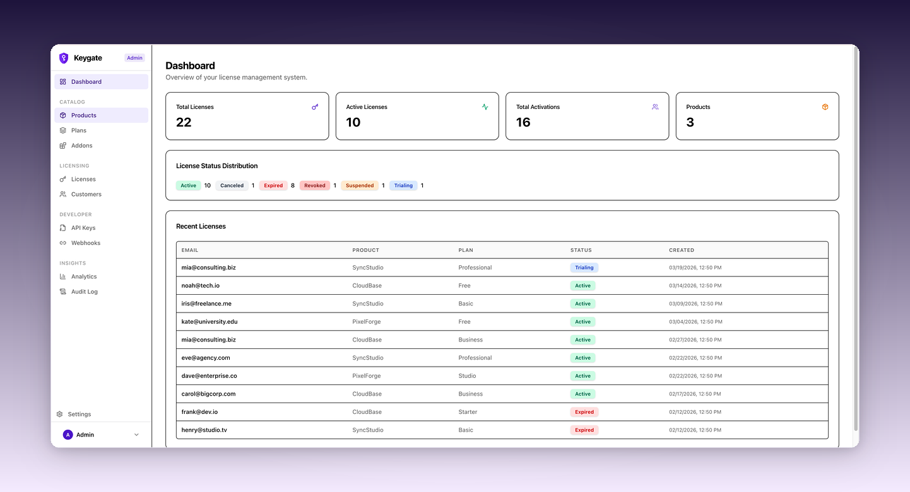

<div align="center">


# Keygate

**Open source software license management platform.**

The self-hosted alternative to Keygen, Cryptlex, and LicenseSpring.

[Website](https://keygate.app) · [Documentation](https://keygate.app/docs) · [Community](https://github.com/tabloy/keygate/discussions)

[](LICENSE)
[](https://github.com/tabloy/keygate/releases)
[](https://github.com/tabloy/keygate/stargazers)
[](https://ko-fi.com/alanisme)

**[English](README.md)** · **[简体中文](README.zh-CN.md)**

<br />



</div>

<br />

## Why Keygate?

You've built great software. Now you need to decide who can use it, how they pay for it, and what features they get access to.

Commercial license platforms charge per-seat, per-month, and your customer data lives on someone else's servers. Building your own takes months of engineering on activation logic, payment webhooks, quota tracking, and all the edge cases that come at 2 AM.

**Keygate is the middle ground.** A production-ready license server you deploy on your own infrastructure, connect to your own Stripe, and manage through a clean dashboard. It handles everything from activation to dunning — so you can focus on building your product.

One server. One database. Full control. Free, forever.

<br />

## Who is it for?

| | |
|:---|:---|
| **🧑‍💻 Indie Developers** — Selling a desktop app, CLI tool, or Electron app? Keygate handles license keys, activation limits, and trials so you can focus on shipping. | **🏢 SaaS Companies** — Managing subscription tiers with different feature sets? Define plans with entitlements, track usage, and let Stripe handle billing automatically. |
| **🏭 Enterprise Vendors** — Need floating licenses for large teams? Concurrent seat checkout with heartbeat monitoring, perfect for shared-seat environments. | **⚡ API Providers** — Enforcing rate limits and usage quotas? Atomic quota enforcement tracks every call and warns customers before they hit limits. |

<br />

## Features

### 🔑 License Management

Every model in one platform — **subscriptions**, **perpetual**, **perpetual with a maintenance period** (buy once, get a year of updates, renew from the portal), **trials**, and **floating** (concurrent) licenses. Create, activate, verify, suspend, reinstate, and revoke with full audit trail. Per-device or per-user activation limits with **atomic enforcement** (no double-counting under retry). Grace periods. License keys hashed with SHA-256, encrypted at rest. Signed tokens for offline verification. **`Idempotency-Key` header** support on writes — retries never duplicate.

Public SDK endpoints (activate / verify / deactivate / usage / download) take `license_key` directly — no embedded API keys to leak from your binaries. Customers can self-serve activation slots from the portal (free up a lost laptop without a support ticket).

#### Standard activations or floating sessions?

Use standard activations when a device may stay offline for an unknown amount of time. A device keeps its activation slot until the customer removes it in the portal. If a device is lost, the customer can sign in, open the license's **Devices** section, remove the old activation, and then activate the replacement device. The portal API lists activations at `GET /portal/licenses/{license_key}/activations` and removes one at `DELETE /portal/licenses/{license_key}/activations/{activation_id}`.

Use floating sessions when a seat should be available to whichever device is using the software now. The client checks out a session, sends heartbeats before the plan's `floating_timeout`, and checks in when it exits. If a device disappears without checking in, its seat stays occupied until the timeout expires; another device cannot take over a live session. That timeout-based recovery makes floating sessions a poor fit when an app must remain usable offline for an unknown amount of time.

The request and response details for these routes are in the [API spec](docs/openapi.yaml).

### 🚀 Software Distribution

Ship signed updates to your installed clients. **Sparkle** (macOS), **Velopack** (Windows), and **Tauri** (cross-platform) updaters all consume the same release feed — one publish, every updater compatible. Per-platform binaries grouped under a single release, **atomic publish gate** (no half-uploaded releases ever leak), **yank** for instant rollback. Per-product **Ed25519 signing keys** with private keys encrypted at rest under AES-256-GCM + HKDF-derived subkeys. Server-side SHA-256 for integrity (never trust the client's hash). Stable feeds are public — your customers' auto-updater never breaks when a license rotates. Products sold with a maintenance period turn on `feed_license_required` — the updater then sends the license and only sees releases published inside the customer's update period, while the app itself keeps running either way. Per-product `minimum_supported_version` floor for forced upgrades.

Object storage is S3-compatible — Cloudflare R2, AWS S3, MinIO, anything that speaks SigV4. Presigned URLs for direct browser upload (no proxying through Keygate), and license-gated short-TTL download URLs.

### 📊 Usage Metering

Track API calls, storage, bandwidth, or any custom metric. Quotas enforced **atomically at the database level** — even under high concurrency, limits are never exceeded. Hourly, daily, monthly, or yearly cycles with automatic reset. Threshold warnings via webhooks.

### 💳 Payments

Stripe integrated end-to-end with **three-layer reliability** — webhook, success-page verification, and periodic sync ensure no payment is ever missed. Customer pays → license created automatically. Payment fails → dunning emails on schedule. Supports checkout, plan upgrades with proration and downgrades that apply at once and are billed from the next invoice, cancellations, refunds, billing portal, and one-time renewals of a perpetual license's update period from the customer portal. Stripe webhook is auto-configured — just set your API key.

Free plans can take **self sign-up**: the plan's `/pay` link becomes a form where a visitor confirms their email with a login code and gets a license key, one per address per product, with an optional daily cap and marketing-consent checkbox (reported in the `license.created` webhook). No card, no Stripe customer.

A license on a free plan shows **Upgrade** in the portal: the customer pays for a paid plan of the same product through checkout, and that same license moves to it — same key, same activations, no re-install. A full refund, or the end of the subscription, puts it back on the free plan instead of revoking it.

A trial plan can name a free plan to fall back to: when a trial ends, the license moves to that plan instead of expiring, with the same key, and the trial ended email tells the customer which plan they carry on with. That plan's limits then apply: devices already activated keep working (a paused member's once they are back) but no new ones can be activated beyond its limit, and members beyond its seats are paused.

### 👥 Seats & Entitlements

A license holds a number of seats: set per plan, or sold per seat through Stripe, with customers adding or removing seats in the portal. The buyer owns the license and holds one seat, and invites members to the others; each member gets a license key of their own, and removing a member stops their key and frees their devices. If a license ends up with more people than seats (say a plan's seat limit is lowered), the members who joined last are paused until a seat is free. The license's own key stays fixed once issued; an admin reissues it when needed. Feature entitlements as boolean flags, numeric limits, or usage quotas. Purchasable add-ons that extend plan capabilities.

### 🔧 Server-to-Server API

Programmatic admin access via `Authorization: Bearer kg_live_…` — mint licenses from your Stripe webhook, run nightly usage exports from cron, automate everything `/admin/*` can do. **Scope-based authorization** with fail-closed defaults (an API key with no scopes can do nothing). System-wide admin keys or per-product keys — same model as Stripe `sk_live_` and GitHub PATs.

### 📈 Admin Dashboard

Products, plans, licenses, customers, API keys, webhooks, analytics, audit logs, team management, email templates, and brand customization — all from one interface. Search, filter, and export (CSV/JSON).

### 🛡️ Security

Email OTP login with constant-time hash verification, role-based access checked per-request from database, brute-force protection, rate limiting, HMAC-signed webhooks, SameSite cookies, HSTS, and startup validation that rejects weak secrets. License verify endpoints collapse all "license-knowable" failures to a single 404 so `license_key` enumeration is closed off. Idempotency-Key middleware prevents double-execution on retried writes.

### 🌍 Self-Hosted

A Go server + PostgreSQL + (optional) S3-compatible storage for release artifacts. No Redis, no microservices. Auto-migration on startup. Setup wizard for first run. Custom branding, email templates, and i18n (English/Chinese built-in).

<br />

## Quick Start

### Docker (recommended)

```bash
# 1. Download
curl -O https://raw.githubusercontent.com/tabloy/keygate/main/docker-compose.yml
curl -O https://raw.githubusercontent.com/tabloy/keygate/main/.env.example
cp .env.example .env

# 2. Set your secrets
# Edit .env: set JWT_SECRET and LICENSE_SIGNING_KEY (openssl rand -hex 32)

# 3. Run
docker compose up -d
```

### From source

```bash
git clone https://github.com/tabloy/keygate.git
cd keygate && cp .env.example .env
make build && ./bin/keygate
```

Open **http://localhost:9000** — the setup wizard guides you from there.

> 📖 Full docs, deployment guides, and SDK examples at **[keygate.app/docs](https://keygate.app/docs)**

<br />

## Compared to Alternatives

| | **Keygate** | Keygen | Cryptlex | LicenseSpring |
|:---|:---:|:---:|:---:|:---:|
| Open source | **✅ AGPL v3** | Partial | ❌ | ❌ |
| Self-hosted | **✅** | ✅ | ❌ | ❌ |
| Price | **Free** | From $99/mo | From $249/mo | From $50/mo |
| Floating licenses | ✅ | ✅ | ✅ | ✅ |
| Usage metering | **✅** | ❌ | ❌ | ❌ |
| Built-in payments | **✅** | ❌ | ❌ | ❌ |
| Auto-update distribution | **✅ Sparkle / Velopack / Tauri** | ✅ Paid add-on | ❌ | ❌ |
| Customer portal | ✅ | ❌ | ✅ | ✅ |
| Admin dashboard | ✅ | ✅ | ✅ | ✅ |
| Webhook system | ✅ | ✅ | ✅ | ✅ |
| Audit trail | ✅ | ✅ | ❌ | ❌ |
| Idempotency-Key | **✅** | ❌ | ❌ | ❌ |
| i18n | ✅ | ❌ | ❌ | ❌ |

<br />

## Community

- **[Discussions](https://github.com/tabloy/keygate/discussions)** — Questions, ideas, show & tell
- **[Issues](https://github.com/tabloy/keygate/issues)** — Bug reports and feature requests
- **[Blog](https://keygate.app/blog)** — Updates and engineering stories
- **[Sponsor](https://keygate.app/sponsorships)** — Support the project

## Sponsors

Keygate is free and self-hosted. If it saves you the cost of a hosted licensing
service, [sponsoring on Ko-fi](https://ko-fi.com/alanisme) keeps development going.

<!-- sponsors:start -->
_Be the first._
<!-- sponsors:end -->

## Contributing

All contributions welcome — bugs, features, docs, translations. Check [open issues](https://github.com/tabloy/keygate/issues) or start a [discussion](https://github.com/tabloy/keygate/discussions), then submit a PR.

## Commercial License

Using Keygate is free, commercially included. Run it for your own business, license the software you sell with it, or serve your own customers from it, and you owe nothing.

The AGPL asks two things in return: the **"Powered by Keygate"** line stays visible in the interface, and if you modify Keygate and let others use it, your changes are published. A commercial license lifts both, which is what white labelling or reselling it as a closed service needs.

Contact [hello@keygate.app](mailto:hello@keygate.app).

## License

[AGPL v3 License](LICENSE) with additional terms per [Section 7(b)](https://www.gnu.org/licenses/agpl-3.0.en.html#section7) — Copyright © 2026 [Tabloy](https://tabloy.app)

You are free to fork, modify, and self-host this software under the AGPL v3. The **"Powered by Keygate"** attribution in the UI must be preserved (see [NOTICE](NOTICE)).

## Star History

<a href="https://star-history.com/#tabloy/keygate&Date">
 <picture>
   <source media="(prefers-color-scheme: dark)" srcset="https://api.star-history.com/svg?repos=tabloy/keygate&type=Date&theme=dark" />
   <source media="(prefers-color-scheme: light)" srcset="https://api.star-history.com/svg?repos=tabloy/keygate&type=Date" />
   
 </picture>
</a>

---

<div align="center">
<sub>If Keygate helps your business, consider giving it a ⭐</sub>
</div>
